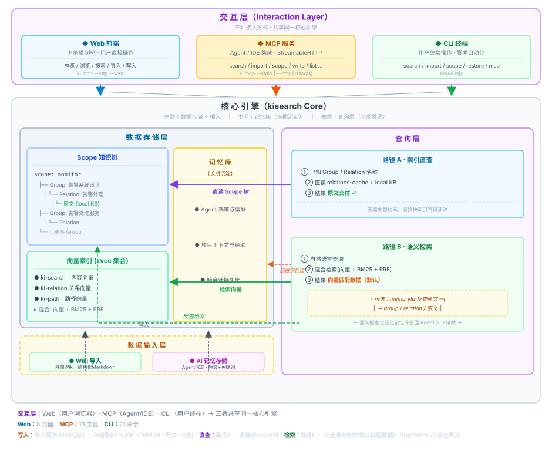
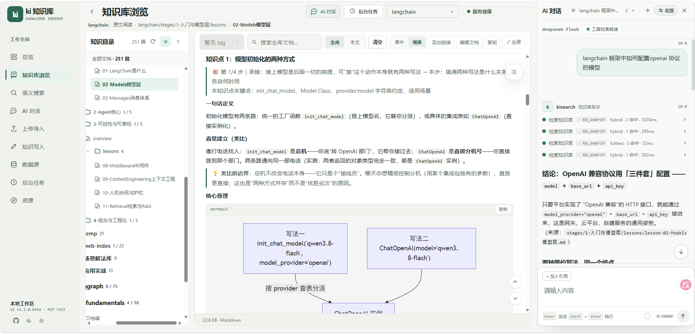

# kisearch

<p align="center">
  <strong>AI Agent 知识索引与长期记忆系统 · RAG 语义检索 + 结构化知识索引</strong>
</p>

<p align="center">
  
  
  
  
</p>

---

## 📑 目录

- [📖 项目介绍](#intro)
- [🧠 Agent 长期记忆](#agent-memory)
- [🆚 与常规 RAG 的差异](#why-not-rag)
- [🧩 核心概念](#concepts)
- [🚀 快速开始](#quickstart)
- [🔌 接入 Agent](#mcp)
- [🛠️ 命令与工具](#cli-commands)
- [🖥️ 内置 Web 前端](#web)
- [📚 文档地图](#docs)
- [🔒 设计约束](#constraints)
- [🤝 参与开发](#contributing)
- [📄 License](#license)

---

## <a id="intro"></a>📖 项目介绍

`kisearch`（CLI 命令：`ki`）是面向 AI Agent 的**结构化知识索引与长期记忆系统**，主要通过 MCP 协议向 Agent 暴露，同时提供 CLI 与内置 Web 前端。它把项目知识组织成 **Group 树 / Relation 结构化视图**，叠加 [**zvec**](https://github.com/alibaba/zvec) 混合检索引擎（语义 + BM25 + RRF 融合），让 Agent 既能「语义搜到」，也能「按索引直查原文」。

```text
发现层  zvec 向量引擎：语义召回 · BM25 全文 · RRF 融合 · 长期持久化
交付层  kisearch：Group 树导航 · Relation 热缓存 · 原文全文交付
记忆层  MCP 工具：Agent 写入 · 更新 · 回忆 · 组织 · 删除
```

**三层架构**



**Web 前端 · 总览页**



## <a id="agent-memory"></a>🧠 作为 AI Agent 的长期记忆系统

知识库解决「有哪些资料可以查」，记忆系统解决「Agent 在不同会话之间需要记住什么、如何更新、何时遗忘」。`kisearch` 用同一套 Group / Relation / 本地 KB / 向量索引同时覆盖两种场景：

| 使用视角 | 典型内容 | 主要操作方式 |
|---------|---------|-------------|
| **知识库** | 外部 Wiki、项目文档、架构说明、API 资料 | `ki import`、`ki search`、MCP 查询工具 |
| **Agent 记忆** | 用户偏好、项目约定、历史决策、排障结论 | Agent 通过 MCP 写入、更新、检索和删除 |

| Agent 动作 | MCP 工具 | 作用 |
|-----------|---------|------|
| 回忆 | `ki_search`、`ki_group_list`、`ki_get_module_info` | 语义检索、按结构导航、读取原文 |
| 记住 | `ki_sync_relation`、`ki_bulk_sync_relation` | 写入带 Group / Relation 的结构化记忆 |
| 更新 | `ki_sync_relation`、`ki_bulk_sync_relation`、`ki_edit_relation` | 整篇覆盖；大 Relation 可多轮按行修改 |
| 组织 | `ki_group_create`、标签、scope | 建立记忆层级、分类和项目隔离 |
| 遗忘 | `ki_delete_relation` | 删除指定 Relation 及其 KB、缓存和向量 |

```text
Agent 从当前对话或代码中提取稳定事实
        ↓
通过 ki_sync_relation 写入结构化记忆
        ↓
后续会话通过 ki_search / ki_group_list 回忆
        ↓
事实变化时覆盖更新；过期或错误时删除
```

> 这里的「记忆」是**可由 Agent 管理的持久化基础设施**：系统负责存储、索引、检索和生命周期管理；是否值得记住、写入什么、何时更新，由 Agent 的工作流或提示词决定。

## <a id="why-not-rag"></a>🆚 与常规 RAG 的差异

常规 RAG 把文档切块 → embedding → 向量检索 → 返回 chunk。kisearch 在此之上叠加结构化知识索引：

| 维度 | 常规 RAG | kisearch |
|------|---------|----------|
| **知识组织** | 无序 chunk，无层级关系 | Group 树 + Relation 索引，知识有归属有层级 |
| **检索结果** | chunk 片段，可能断裂缺上下文 | 原文全文（命中时可直接引用原文） |
| **查询路径** | 仅语义检索一条路 | **双路径**：已知索引时精准直查；未知时语义检索兜底 |
| **原文定位** | 黑盒召回 | 每条结果带 `group` / `relation` 定位字段 |
| **符号检索** | 弱（纯语义向量，camelCase 难匹配） | BM25 全文路支持类名 / 方法名精确召回 |
| **状态管理** | 无状态 | 冷热治理 + 评分衰减 + 使用计数，热点优先 |
| **跨会话** | 一次性检索，无积累 | 长期记忆库，Agent 沉淀的知识持续积累 |

> **一句话**：常规 RAG 解决「搜得到」，kisearch 同时解决「搜得到 + 看得见 + 定位到原文」。

## <a id="concepts"></a>🧩 核心概念

| 概念 | 含义 |
|------|------|
| `scope` | 项目隔离标识，不同 scope 物理隔离（`scopeMode: default` 自动创建 / `strict` 需注册） |
| `Group` | 知识分组路径，如 `项目/告警系统设计/告警处理服务` |
| `Relation` | 某个 Group 下可被检索和命中的知识条目（含 memoryId / sourcePath） |
| `module-info` | Relation 对应的 Markdown 原文 |
| 标签（Tag） | `ki-search`（内容）/ `ki-path`（路径）/ `ki-relation`（关系）三层标签 |
| 记忆（Memory） | Agent 可跨会话持续积累、更新和删除的知识，带评分衰减与冷热治理 |

## <a id="quickstart"></a>🚀 快速开始

### 1. 安装

```bash
# 方式一：一键安装 CLI（推荐）
curl -fsSL https://raw.githubusercontent.com/HACK-WU/kisearch/master/scripts/install-latest.sh | bash

# 方式二：源码安装
git clone git@github.com:HACK-WU/kisearch.git && cd kisearch
npm install && npm link
npm run build:zvec-engine   # 必需：运行时从 dist/zvec-engine 加载向量引擎
```

### 2. 初始化配置

```bash
ki config init        # 生成 ~/.ki/config.yaml
ki doctor             # 校验配置、目录、Embedding 密钥与向量维度
```

```yaml
dataDir: $HOME/.ki/kb
backupDir: $HOME/.ki/backup
vectorDir: $HOME/.ki/vector        # 每个 scope 独立 Collection：collections/<scope>
embedding:
  provider: siliconflow
  apiKey: ${SILICONFLOW_API_KEY}   # 显式引用环境变量，不做隐式回退
  model: Qwen/Qwen3-Embedding-8B
  dimension: 4096                  # 必须与建库时一致
  queryTimeoutMs: 3000             # 查询 embedding 超时（ms）
scopeMode: default                 # default 自动创建 scope；strict 需显式注册
```

> `SILICONFLOW_API_KEY` 需在环境中导出；MCP 场景必须在客户端 `env` 字段显式传入（MCP 进程不继承 shell 环境）。完整配置项见 [`docs/configuration.md`](./docs/configuration.md)。

### 3. 导入外部 Wiki

```bash
ki import \
  --scope my-project \
  --source /path/to/wiki \
  --group Wiki \
  --chunk-size 1000 \
  --chunk-overlap 150
```

幂等追加：重复执行同一条命令即增量更新（内容未变不重算；同名不同来源默认覆盖，需保留旧文档时用 `--conflict-mode suffix`）。参数与冲突策略见 [`docs/import.md`](./docs/import.md)。

### 4. 验证检索

```bash
ki search "用户登录流程" --scope my-project
```

结果带 `group` / `relation` 定位字段；需要整篇原文时加 `--original`。查询技巧见 [`docs/query-kb.md`](./docs/query-kb.md)。

### 5. 启动 MCP 与 Web 前端

```bash
cd web && npm install && npm run build && cd ..   # 仅首次或前端改动后需要
ki mcp --http --web
# 浏览器打开 http://127.0.0.1:7423/
```

## <a id="mcp"></a>🔌 接入 Agent

HTTP 模式（推荐，多 IDE / 远程共享同一进程）：

```json
{
  "mcpServers": {
    "ki": {
      "url": "http://127.0.0.1:7423/mcp",
      "headers": { "Authorization": "Bearer <your-token>" }
    }
  }
}
```

- 回环绑定（仅本机）免鉴权时可省略 `headers`；跨机访问需绑定 `0.0.0.0` 并强制 Token。
- stdio 模式用 `{"command": "ki", "args": ["mcp"], "env": {"SILICONFLOW_API_KEY": "..."}}`，它会桥接到本机 daemon，不会另开向量库持锁进程。
- 连接 URL 需与 `ki mcp --status` 输出的 `host` / `port` 完全一致。

```bash
ki mcp --http --web                    # 启动（HTTP + 前端）
ki mcp --http --daemon                 # 后台常驻
ki mcp restart                         # 重启（幂等，等待就绪后返回）
ki mcp --status                        # 只读查看状态
ki mcp stop                            # 关闭本机所有实例并清理 lock

ki mcp token generate --scope team-a   # 生成授权 Token（单个 / 逗号分隔多个 / all）
ki mcp token list                      # 列出 Token（含明文与授权 scope）
ki mcp token update <id> --scope team-b
ki mcp token delete <id>
```

> 启动前会自动预检：配置/目录/无效密钥等硬错误 fail-loud；embedding 网络暂不可用只告警并继续启动。详见 [`docs/mcp-http.md`](./docs/mcp-http.md)。

## <a id="cli-commands"></a>🛠️ 命令与工具

| 命令 | 说明 |
|------|------|
| `import` | 外部 Markdown 导入（幂等追加；`--conflict-mode` / `--no-vector` / `--no-assets`） |
| `datasource` | 数据源登记与同步：`add` / `sync` / `prune` / `list` / `remove` |
| `group` | Group 管理：`create` / `delete` / `list` |
| `get-module-info` | 读取本地 KB 原文（批量 ≤10 条） |
| `sync-relation` | 写入 / 更新 Relation + 本地 KB |
| `delete-relation` | 删除单条 Relation（cache / KB / wiki / 向量四层） |
| `search` | 语义检索（`hybrid` 默认 / `fulltext` 不调用 embedding） |
| `store` / `bulk-store` | 只写向量层（单条 / 批量） |
| `scope` | scope 管理：`list` / `delete` / `clear` |
| `doc` | 向量文档：`list` / `delete` |
| `tag` | tag 发现：`list` |
| `config` | 配置：`init` |
| `doctor` | 配置与连通性诊断 |
| `backup` / `restore` | scope 快照备份 / 恢复（`--rebuild-vector` 重建向量） |
| `export` | 导出 KB 为 Markdown |
| `wiki-backfill` | 历史 Relation 写回 Wiki |
| `migrate-relation-cache` | 元数据布局迁移（v3 per-Group 分片） |
| `index-optimize` | 索引整理（失败重试 / 存量整理） |
| `mcp` | MCP 服务（stdio / `--http` / `--status` / `token`） |

> 完整参数：`ki <command> --help` 或 [`docs/cli.md`](./docs/cli.md)。
> MCP 共暴露 **13 个工具**，参数见 [`docs/mcp-tools.md`](./docs/mcp-tools.md)。MCP 不提供 scope / doc 级联删除与 `--force` 操作，需要时用 CLI。

## <a id="web"></a>🖥️ 内置 Web 前端

`ki mcp --http --web` 一并提供浏览器界面（`http://127.0.0.1:7423/`），用于导入后验证写入效果、排查检索异常：

| 页面 | 用途 |
|---|---|
| 总览 | scope / KB / 向量 / 数据源 / 当前 scope 状态 |
| 知识库浏览 | Group 树 + 文档列表 + 文件名/路径搜索 |
| 语义搜索 | hybrid / fulltext 检索，结果可跳原文 |
| AI 对话 | 多轮问答、流式输出、检索来源可点击回原文；独立页面 + 全站右侧面板 |
| 上传导入 | 浏览器内选择/拖拽目录导入，含重复预检与清理候选 |
| 知识写入 | 在线写入 Relation 与正文 |
| 数据源 | 已登记的本地目录 / Git 数据源；可添加 Git 源、触发同步、清理待删候选 |
| 后台任务 | 导入/同步任务进度、结果明细与重试 |

> AI 对话需在配置 `llm` 段填写 `baseURL` / `model` / `apiKey`；未配置时面板显示「未配置模型」，其余功能不受影响。

## <a id="docs"></a>📚 文档地图

完整索引见 [`docs/README.md`](./docs/README.md)，按「我想做什么」查找。

| 分组 | 包含 |
|------|------|
| 入门 | [首次构建](./docs/build-kb.md)、[配置](./docs/configuration.md)、[导入](./docs/import.md)、[验证](./docs/verify-index.md) |
| 操作 | [查询](./docs/query-kb.md)、[Group 管理](./docs/group.md)、[备份恢复](./docs/backup-restore.md)、[典型工作流](./docs/workflows.md) |
| 参考 | [CLI](./docs/cli.md)、[MCP HTTP](./docs/mcp-http.md)、[MCP 工具](./docs/mcp-tools.md)、[错误处理](./docs/error-handling.md) |
| 机制 | [架构](./docs/architecture.md)、[向量引擎](./docs/vector-engine-mem.md)、[标签设计](./docs/tags-design.md) |
| Agent | [Skill / Rule 集成](./docs/agent-integration.md)、[命令速查](./docs/ki-command-guide.md)、[行为规则](./docs/codekb-agent-guide.md) |

## <a id="constraints"></a>🔒 设计约束

- **Scope 隔离**：仅允许字母、数字、连字符、下划线；禁止路径遍历；不同 scope 物理隔离
- **WAL 写入**：JSON 写入采用临时文件 → 原子 rename
- **幂等安全**：重复操作无副作用（重复导入覆盖更新）
- **快速失败**：输入校验失败立即退出，不静默降级
- **异常恢复**：运行时数据损坏自动从 `_template/` 恢复
- **MCP 安全边界**：不暴露 scope / doc 级联删除与 `--force`

## <a id="contributing"></a>🤝 参与开发

```bash
npm install
npm run build:zvec-engine        # 构建向量引擎层（tsc）
npm test                         # 单元测试
npm run test:zvec-engine         # 引擎测试（node --test）
npm run test:all                 # 全部单元测试
npx jiti src/search.ts --help    # 直接执行任意命令
```

## <a id="license"></a>📄 License

MIT
