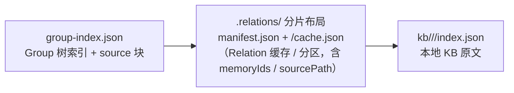
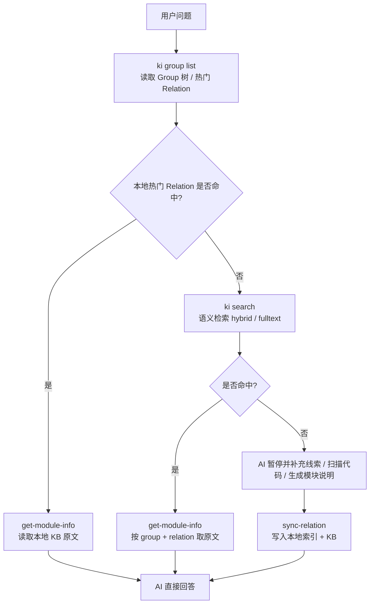
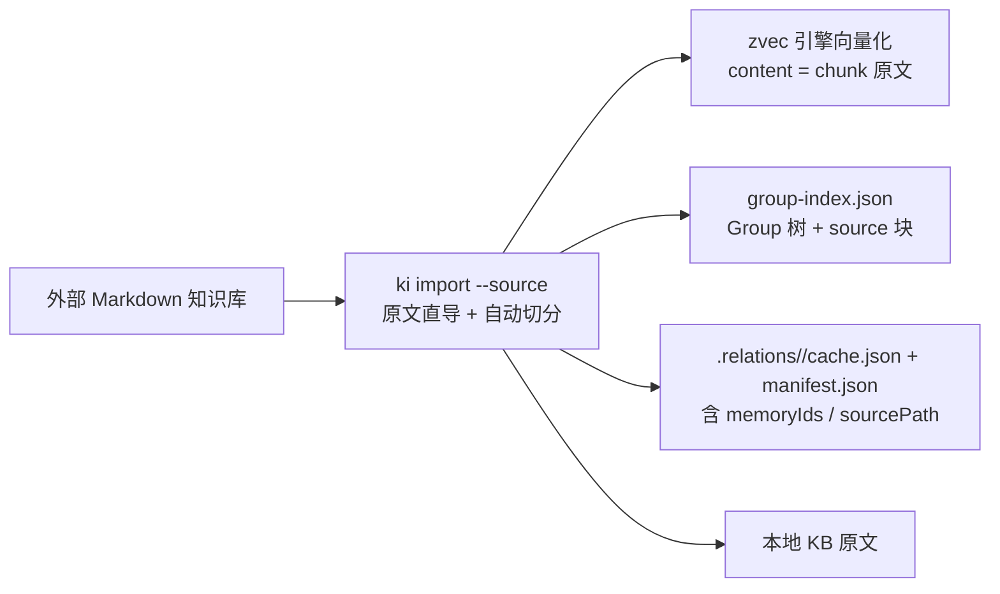
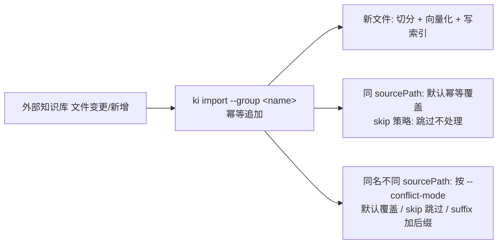

# 架构说明

`knowledge-index`（kisearch）是一个**本地知识索引与向量检索系统**，基于 zvec 向量引擎，提供完整的知识管理能力。

核心能力：

- **结构化导航**：把知识整理成 Group 树，便于 Agent 先缩小范围
- **原文交付**：把模块说明保存在本地 KB 中，便于 Agent 直接读取 Markdown 原文回答问题
- **向量检索**：基于 zvec 引擎的混合检索（dense + FTS），毫秒级响应

## 整体架构

```mermaid
flowchart TB
    U[用户 / MCP Client / AI Agent]
    KI[knowledge-index<br/>Group 树 + Relations 缓存 + 本地 KB]
    MCP[ki MCP Server<br/>常驻服务]
    ZVEC[ZvecEngine<br/>@zvec/zvec Rust 内核]
    DATA[(zvec DB 文件<br/>持久化向量)]

    U --> KI
    U --> MCP
    KI --> ZVEC
    MCP --> ZVEC
    ZVEC --> DATA
```

## 分层职责

| 组件 | 主要职责 |
|------|------|
| `knowledge-index` | Group 导航、热门 Relation 缓存、本地 Markdown 原文交付、CLI 命令 |
| `ki MCP Server` | 常驻 MCP 服务，暴露 13 个工具（检索 / 读取 / 写入 / 组织 / 删除），见 [mcp-tools.md](./mcp-tools.md) |
| `ZvecEngine` | 进程内向量引擎：insert/upsert/hybridSearch，Embedding 集成 |

## knowledge-index 内部结构



### 核心文件

| 文件 | 角色 | 读写方 | 生命周期 |
|------|------|--------|---------|
| `group-index.json` | Group 树结构索引 + `source` 块（`dir` + 切分参数） | 所有脚本读写 | 永久，随 Group 增删改 |
| `.relations/<groupPath>/cache.json` | Relation 缓存分片（评分/分区，存储不设上限），含 `memoryIds`/`sourcePath`；per-Group 一份 | 所有脚本读写 | 永久，随 Relation 使用动态更新 |
| `.relations/manifest.json` | scope 级元数据：`partition_config` + `revision`（缓存失效身份锚，每次写递增） | 存储原语自动维护 | 永久 |
| `relations-cache.json`（旧布局） | 单文件时代的关系缓存；首次写入时自动迁移为分片布局，旧文件改名 `.bak` 保留 | 仅回退用 | 过渡期保留 |
| `kb/{scope}/{group}/index.json` | 本地 KB 原文 | get-module-info 读，sync-relation/import 写 | 永久，随知识沉淀积累 |

> **关联元数据按 Group 分片**：每组一份 `<scope>/.relations/<groupPath>/cache.json`，scope 级字段（`partition_config` + `revision`）在 `.relations/manifest.json`，读单篇文档只碰该组分片。分片根用点号保留名 `.relations/`，避免与名为 `relations` 的顶层组目录冲突（删组时会连根带走全部元数据）。旧单文件布局的库在首次写入时自动迁移，旧文件改名 `.bak` 保留。
>
> **组键原样作路径段**：同一个 `groupPath` 同时是 `group-index.json` 的树节点、本地 KB 目录（`kb/<scope>/<groupPath>/`）与分片目录；任一侧改写都会让三者分叉。
>
> **分区上限只是展示口径**：`partition_config.maxHotCount`（默认 10）只截断 `ki group list` 的 hot 展示区，**不是存储上限**——Relation 全量持久化于 `hot_relations`，无逐出机制；热区溢出回流常温/冷区，`hot + warm + cold` 恒等于全量（唯一例外：显式配置 `maxColdCount` 时冷区末端截断）。`warmPercent` 以热区之外的候选池为基准；Group 聚合分取组内 Relation 评分的**均值**，避免规模压倒活跃度。

### `group-index.json` 的 `source` 块

记录外部知识库来源信息，用于 Wiki 写回定位源目录：

```json
{
  "version": 1,
  "scope": "qoder-wiki",
  "groups": { "wiki": { ... } },
  "source": {
    "dir": "/abs/path/to/source"
  },
  "updatedAt": "2026-05-28T05:17:22.360Z"
}
```

- `dir`：外部知识库目录绝对路径（`ki import` 自动记录，Wiki 写回据此定位源文件）
- `chunkSize` / `chunkOverlap`：切分参数持久化（缺失时回退默认值）

### relations 元数据的 `memoryIds` / `sourcePath`

`ki import` 产生的是**文件级 relation**：一条 relation 挂该文件全部 chunk 的向量 ID。

| 字段 | 含义 |
|------|------|
| `memoryIds` | 该文件全部 chunk 的向量 ID。`ki search` 命中任一 ID 即可反查同一文件、返回原文（开启 `--original` 时）；旧数据可能是单值 `memoryId` |
| `sourcePath` | 相对 `source.dir` 的 posix 路径，幂等判定与同名冲突策略都以它为准 |

`index.json` 的 key 由写入方决定：`ki import` 用文件名（去 `.md`），`ki sync-relation` 用 `--relation` 原文。

## 运行时主链路



## 外部知识库导入链路



### 增量更新链路（幂等追加）



> 增量更新由「幂等追加」承载：重复执行同一条命令即同步变更，不依赖 git。

## 向量层（zvec）

检索由进程内嵌的 zvec 引擎提供（`@zvec/zvec` 的 Rust 内核 + Node 绑定），不经外部 CLI、无需额外进程：

- **隔离**：每个 scope 一个独立 Collection，向量同时带 `scope` metadata，双重隔离
- **混合检索**：dense 向量与全文索引（`jieba` 分词）同时召回后用 RRF 融合，也可单独走语义或全文
- **自动向量化**：写入时由引擎按 `text` 调用 embedding，模型与维度见 [configuration.md · embedding](./configuration.md#embedding)
- **硬过滤**：按 metadata（`tag` / `scope` / `group`）在引擎内过滤，不做客户端 post-filter

选择嵌入式引擎而不是外部 CLI，是因为延迟与召回：外部 CLI 每次调用都要冷启动（秒级），进程内常驻后单次查询在毫秒级，同一批数据的召回率也更高。

## 三层标签

向量库用 metadata 字段 `tag` 把三类内容物理隔离，召回时互不污染：

| 标签 | 定位 | 写入方 | 消费方 |
|------|------|--------|--------|
| `ki-path` | Group 路径层级索引，每个 Group 一条 | `ki import` | 路径模糊匹配（`ki group list`、语义兜底） |
| `ki-relation` | Relation 名称索引，每个 Relation 一条 | `ki import`、`ki sync-relation` | Relation 名称模糊匹配 |
| `ki-search` | 通用语义检索 | `ki import`、`ki store`、`ki bulk-store`、`ki sync-relation`、`ki edit-relation`（含文档编辑）、MCP 写入 | `ki search` / MCP 检索（默认） |

- `ki-path` / `ki-relation` 是**内部基础设施**，只为路径与关系名的模糊匹配服务；`ki-search` 才是用户与 Agent 日常检索的数据源。
- 写入时用 `tag` 字段（批量接口参数名为 `tags`）指定归属，缺省落 `ki-search`——辅助标签必须显式传，否则内容会混进通用检索空间。
- 额外业务标签（`--tags`）以「同内容多 doc」实现——每个标签一条记录，id 由 `text + scope + tag` 派生；检索时按 OR 召回，内部保留标签会被过滤。
- 标签只影响**新写入**：改了查询侧标签，历史数据不会跟着改，召回范围随之变化；需要重建时用 `ki restore <scope> --rebuild-vector`（三类标签向量按同一规则重算）。

## 知识库与 Agent 记忆的关系

kisearch 用**同一套** Group / Relation / 本地 KB / 向量索引同时承载两类内容：

| 视角 | 典型内容 | 主要入口 |
|------|---------|---------|
| 知识库 | 外部 Wiki、项目文档、架构说明、API 资料 | `ki import`、`ki search`、MCP 只读工具 |
| Agent 记忆 | 用户偏好、项目约定、历史决策、排障结论 | MCP 写入 / 更新 / 删除工具 |

- **读取**：先索引直查（Group → Relation → 原文），未命中再做语义检索。
- **写入**：统一走 `ki sync-relation` / `ki_bulk_sync_relation`，自动补建 Group 树。
- **演化**：热点内容留在热区，长尾内容由检索召回；是否记住、写什么、何时更新由 Agent 的工作流决定。
