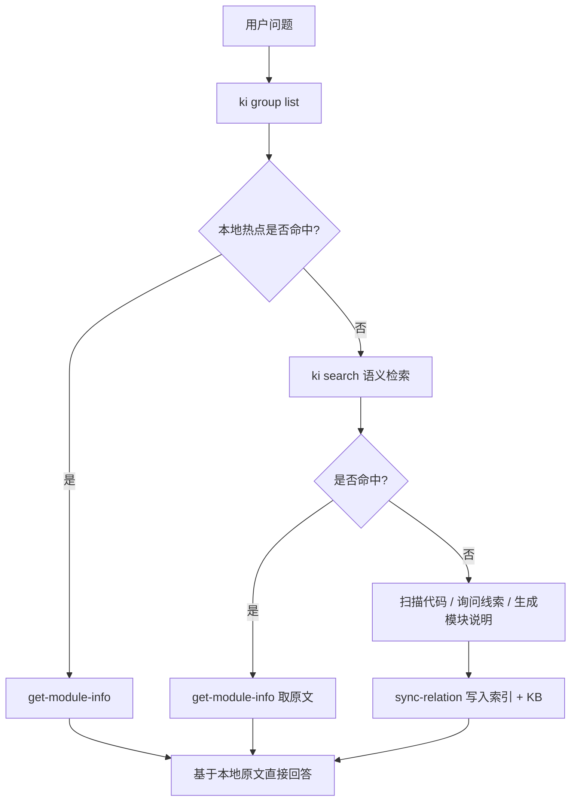

# 典型工作流

把 `kisearch` 最常见的使用方式整理成可直接执行的流程，覆盖 3 类场景：

- **本地知识沉淀**：人工或 AI 主动写入项目知识
- **查询闭环**：索引直查优先，未命中再走语义检索
- **外部知识库导入**：首次导入 / 幂等增量更新

---

## 工作流一：手工沉淀一条项目知识

适合场景：

- 已经明确知道某个模块要怎么描述
- 希望把它直接写进本地索引
- 希望以后能被快速命中和读取

### 步骤 1：创建顶层 Group

```bash
ki group create "API" --scope my-project
```

### 步骤 2：创建 Group

```bash
ki group create "我的项目/API" --scope my-project
```

### 步骤 3：写入 Relation 和模块说明

```bash
ki sync-relation \
  --scope my-project \
  --group "我的项目/API" \
  --relation "用户登录接口" \
  --module-info "## 登录流程\n用户输入账号密码后进入认证流程，服务端校验成功后返回 token。"
```

### 步骤 4：查看写入效果

```bash
ki group list \
  --scope my-project \
  --groups "我的项目/API"
```

### 步骤 5：读取原文

```bash
ki get-module-info \
  --scope my-project \
  --group "我的项目/API" \
  --relation "用户登录接口"
```

---

## 工作流二：运行时查询闭环

AI Agent 在回答用户问题时的典型路径：



---

## 工作流三：外部知识库导入

> 前置条件：`scopeMode: default`（默认）下首次使用会自动创建 scope；`scopeMode: strict` 下需先在 `~/.ki/config.yaml` 的 `scopes` 中注册。

### 首次导入（原文直导，1 步）

**一条命令完成**：

```bash
ki import \
  --scope my-project \
  --source /path/to/wiki \
  --group QoderWiki
```

内部完成：递归扫描 .md → 逐文件切分（大文档自动切分）→ 批量 zvec 引擎向量化（content = chunk 原文）→ Group 树创建 → `relations-cache` 写入（文件级 relation 挂 `memoryIds` 多值 + `sourcePath`）→ `group-index.source` 块记录（含切分参数持久化）。

**可选：导入时打标**（附加 `--tags <t1,t2>`）：为导入文件附加自定义标签，每个 tag 各写一条内容向量，导入后即可 `ki search -t <tag>` 召回；标签持久化到 `relation.tags`，后续 `ki restore <scope> --rebuild-vector` 可自动恢复。注意：不带 `--tags` 重导会清除已有标签（导入为覆盖语义，区别于重建打标的只增不减）。

### 增量更新（幂等追加，1 步）


```bash
# 修改 / 新增 source 目录中的文件后，重新执行同一条 import 命令即可
ki import \
  --scope my-project \
  --source /path/to/wiki \
  --group QoderWiki
```

幂等语义（文件级）：
- 同文件重导（sourcePath 相同）→ 覆盖更新
- 同名不同文件（sourcePath 不同）→ 跳过
- 新文件 → 正常导入

---

## 工作流四：排障时怎么判断自己卡在哪一步

- **`ki import` 报 `unknown scope: "X"（scopeMode=strict）`**：scope 未在 `config.yaml` 注册，或改用 `scopeMode: default`
- **`ki import` 报 `--source 目录不存在或不是目录`**：确认 `--source` 指向的 Markdown 目录存在
- **`ki import` 报 `--group 不能为空`**：`--group` 未传或为空（缺省会落到 `default` group）
- **追加后 `ki search` 召回不到**：确认导入未用 `--no-vector`（非向量化模式不产生 memoryId，无法被召回）

---

## 最推荐的落地策略

1. 先用 `ki import --group <name>` 跑通首次导入
2. 之后变更：修改/新增 source 目录文件后重新执行同一条 `ki import` 命令（幂等追加 = 增量更新）
3. 查询时遵循"本地优先，记忆兜底，命中后回写"的闭环

## 相关文档

- `ki import` 详细说明：[`import.md`](./import.md)
- 异常与恢复：[`error-handling.md`](./error-handling.md)
- 架构与数据文件关系：[`architecture.md`](./architecture.md)
- 备份与恢复：[`backup-restore.md`](./backup-restore.md)
